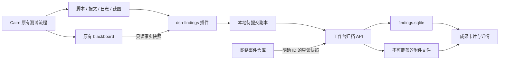

# Cairn 漏洞成果库与证据归档插件 Spec

- 状态：设计草案，待实现。
- 版本：v0.1。
- 日期：2026-09-22。
- 适用项目：ct-st3，本机单用户渗透测试工作台。
- 核心决策：保持 Cairn 搜索引擎与画板协议不变，新增独立 `dsh-findings` 插件，在工作台持久化漏洞成果与证据，以卡片和详情页展示。

## 1. 背景与目标

用户在 Cairn 模式下发现漏洞后，需要保存的不只是结论，还包括利用前提、复现方式、实际使用的 PoC、HTTP 请求与响应、截图、工具输出。成果应在测试结束、服务重启、源工作区或网络历史清理之后仍然可查看。

Cairn 画板中的 `Fact` 仅包含 `id` 和 `description`，也会记录普通发现和验证失败。画板适合作为来源索引，不能直接转换成完整漏洞报告；画板状态 `completed` 也不能作为漏洞成立的判据。

本方案提供一条独立归档路径：Agent 通过原有工具完成测试并留下证据，再调用 `archive_finding` 提交结构化说明和证据引用。归档系统保存证据副本、返回成果 ID，并在工作台展示卡片。

### 1.1 “不改变 Cairn 核心逻辑”的定义

必须保持以下部分不变：

- `dsh-cairn-search/src/board.ts` 的状态机、调度、事实追加与任务完成规则。
- `blackboard` 的参数、返回结构、`Fact` / `Intent` / `Board` 数据格式。
- `claim`、`conclude`、`reason_start`、`reason_finish` 等操作的原有行为。
- 子代理共享主会话画板、会话 fork 拥有独立画板的规则。
- 原有模型、代理、审批、网络捕获和 PoC 执行路径。

允许新增：独立插件、工作台 API、存储与 UI；在 Cairn preset 中增加插件挂载和独立归档说明。原 `state-space-search` skill 不改写。

新增工具和说明会占用少量模型上下文，并增加归档调用，因此不承诺模型输出与未安装插件时完全一致。这里保证的是核心代码、协议和搜索规则不变。

### 1.2 非目标

- 不自动执行 PoC、重放请求、重新利用漏洞或启动浏览器验证。
- 不把每条 fact、模板命中或模型判断自动标记为已确认漏洞。
- 不保证恢复此前没有保存的截图、脚本或完整报文。
- 不建设多用户权限系统、远程证据上传服务或公开分享功能。
- 不在首版实现跨会话自动合并、LLM 批量抽取历史会话、自动生成正式报告。

## 2. 当前项目基础与限制

以下是本次代码检查确认的已有能力；后续章节中的新模块和接口均为拟新增。

| 现状 | 代码位置 | 对方案的影响 |
| --- | --- | --- |
| 成果库导航已存在，正文是占位页 | `web-ui/src/App.tsx` | 接入独立成果页，保留路由 ID `evidence` |
| 工作台能读取注册工作区的会话画板 | `backend/src/workbench/blackboards.py` | 复用只读查询，归档关联事实快照 |
| 画板按主会话保存，子代理共享，fork 独立 | `dsh-cairn-search/src/owner.ts` | 分别记录执行会话与 owner，不能仅按 fact ID 去重 |
| 工作台 Run 独立于 Cairn 会话 | `backend/src/workbench/control.py` | `run_id` 为可选关联，禁止默认绑定归档时的当前 Run |
| HTTP 时间线存在按事件 ID 查询的能力 | `backend/src/workbench/netstore.py`、`api.py` | 按明确事件 ID 导入请求响应快照 |
| PoC 扫描可记录请求事件 ID | `backend/src/workbench/poc_recording.py` | 可用 `network_event_id` 关联；仅在捕获和 Run 条件满足时存在 |
| PoC 返回响应包文本及其静态截图 | `backend/src/workbench/poc.py`、`poc_evidence.py` | 可接入，但不能称为浏览器页面截图 |

现有 `HttpEvent` 使用 header 字典和 body 字符串。`decode_body` 会解码字节，重复 header 也可能合并。因此，从时间线导入的是解析后的 HTTP 快照，不保证原始线上字节、header 顺序、重复字段或传输编码可以恢复。API 中的 `truncated` 字段名也不能单独用来判断是否发生截断。

网络时间线的时间窗口工具关联只能作为线索，不作为证据属于某个 Cairn 会话的确定依据。没有具体事件 ID 时，应保存真实报文文件，或标明 HTTP 证据未采集。

## 3. 用户流程

### 3.1 首次归档

1. Cairn 继续按原流程探索和验证，通过已有工具留下脚本、日志、报文或截图。
2. Agent 整理标题、目标、利用前提、复现步骤、预期与实际结果。
3. Agent 调用 `archive_finding(op=create)`，提供本次发现的证据文件和明确的网络事件 ID。
4. 插件从执行上下文读取工作区与会话信息，检查附件并准备本地提交副本。
5. 后端校验并持久化成果与附件，返回 `finding_id`。
6. “漏洞成果库”出现“待复核”卡片，详情中展示说明、附件和采集缺口。

### 3.2 补充证据与人工复核

- Agent 通过 `op=append` 给已有成果追加证据与补充说明，保留已有附件。
- 用户在详情页编辑漏洞信息、查看证据，并设定人工复核状态。
- 人工设为“误报”或“已确认”后，Agent 追加材料不能覆盖该状态。
- 更新字段和状态产生审计记录；对已经人工确认的内容进行重大修改时，UI 提示重新复核，不自动替用户改变结论。

### 3.3 缺证据或归档失败

- 缺少某类材料可以保存为待复核成果，但必须明确列入 `evidence_gaps`。
- 声明要上传的文件不存在、网络事件 ID 无效、文件写入失败时，本次提交失败，不能静默漏掉附件后报告成功。
- 用户或 Agent 可移除错误引用并明确声明缺口，形成新的提交；不能把失败附件自动改成“已采集”。
- 网络故障时保留本地待提交副本，返回重试标识；不改变画板，不阻塞后续搜索调度。

## 4. 架构与模块职责



| 模块 | 职责 |
| --- | --- |
| `dsh-findings` | 注册归档工具；解析来源；读取允许的附件；生成清单和哈希；上传；持久化待重试请求 |
| 工作台 Findings 服务 | 校验模型和引用；导入网络快照；提交附件和元数据；处理幂等、查询、编辑及审计 |
| Findings UI | 卡片、筛选、详情、编辑、人工复核、附件预览与下载 |
| Cairn 插件 | 保持原职责，不依赖 Findings 服务，不接收归档回写 |

不在 `conclude` / `reason_finish` 中植入保存逻辑，不监听其成功作为漏洞自动成立的信号。归档请求只发送到配置的本机工作台 API。

## 5. 归档工具契约

工具名：`archive_finding`。包含 `create`、`append`、`retry` 三种操作。

| 字段 | 适用操作 | 约束 |
| --- | --- | --- |
| `op` | 全部 | `create` / `append` / `retry` |
| `finding` | create | 结构化漏洞信息，字段见下文 |
| `finding_id` | append | 必须引用已存在成果 |
| `note` | append | 补充说明；不覆盖原始描述 |
| `fact_ids` | create / append | 可选；只关联当前 owner 画板中的事实 |
| `artifacts` | create / append | 文件证据清单，包含类型、路径、说明和对应复现步骤 |
| `network_refs` | create / append | 明确的 `event_id`、`run_id`；后端验证事件所属 Run |
| `evidence_gaps` | create / append | 缺失或不适用的证据类别及原因 |
| `resolved_gap_ids` | append | 明确解决的已有缺口 ID；需有补充说明或对应证据，不自动按附件类型消除缺口 |
| `occurrence_id` | create / append | 可选；由调用方为独立的重复验证提供不同标识，纳入幂等摘要；retry 保留原值 |
| `submission_key` | retry | 引用插件已经持久化的提交；不重新读取被改动的源文件 |

`finding` 必须包含 `title`、`target`、`summary`、`severity`、`preconditions`、`steps`、`expected_result`、`actual_result` 和 `agent_assessment`。风险等级允许 `unknown`；未知或尚未验证的信息应明确填写，不能虚构细节凑齐字段。

`steps` 为带稳定 `id` 的步骤数组，可关联附件的 `client_id`。复现步骤只作为文本保存，不由成果库执行。`agent_assessment` 取值 `suspected` / `reproduced`，表达模型报告的判断。

`client_id` 在一次 submission 内唯一，只允许字母、数字、下划线和连字符，不作为文件系统路径直接使用。提交时将步骤引用转换成最终 `artifact_id`，同时保留原始清单映射。append 仅给已有步骤关联新附件，不增删步骤，也不重复上传旧附件；需要修改步骤时由用户通过编辑接口处理，并保留旧版本与历史关联。

文件证据项示例：

```json
{
  "client_id": "artifact-poc-1",
  "kind": "poc",
  "path": "evidence/check.py",
  "description": "本次验证使用的脚本",
  "step_ids": ["step-2"],
  "capture_method": "tool_file",
  "captured_at": null
}
```

以上路径只是格式示例，不代表已存在文件。截图时间无法从可信采集记录确认时保留空值；Agent 填写的采集时间记录为来源声明，不能视为经过平台独立验证。

### 5.1 执行来源

来源信息由插件生成，不接受模型覆盖：

- `workspace_path`：执行会话 `header.cwd` 的规范路径；查到工作区注册 ID 时一并保存。
- `session_id`：当前执行会话 ID。
- `owner_session_id`：按现有子代理父链规则解析；UI fork 为独立 owner。
- `source_type`：`cairn`；人工录入则为 `manual`。
- `fact_snapshots`：按 `fact_ids` 只读取得的 ID 和原文，不修改或初始化画板。

没有工作区或会话上下文时，Agent 工具返回 `context_missing`。父链无法可靠解析时记录 `owner_resolution=unresolved`，不猜测归属，也不读取可能属于其他会话的画板；没有 fact 引用的成果仍可按执行会话保存。

首版不自动合并 fork 或不同会话的成果。一个成果允许多个来源、多个事实；一条事实也可能支持多个不同漏洞。

### 5.2 返回结构

成功示例：

```json
{
  "ok": true,
  "submission_key": "sub-example",
  "finding_id": "finding-example",
  "review_status": "pending",
  "saved_artifacts": 4,
  "evidence_gaps": [],
  "warnings": ["HTTP 证据来自解析后的网络快照，不保证原始字节一致"]
}
```

失败返回 `ok=false`、`error_code`、`message`、`retryable`，以及已经成功落盘时才有的 `submission_key`。插件不能以“稍后可能上传成功”冒充归档成功。

## 6. 证据类型与真实性

| kind | 内容 | 展示与约束 |
| --- | --- | --- |
| `poc` | 实际保存的 PoC 文件 | 代码查看、下载；保存命令说明，不执行 |
| `http_snapshot` | 从网络仓库导入的结构化请求响应 | 显示事件 ID、所属 Run、来源及已知转换；可生成报文视图，标明为重建展示 |
| `http_request` / `http_response` | 工具保存的请求 / 响应文件 | 按提交文件原字节保存；是否为原始线上报文单独标记 |
| `browser_screenshot` | 浏览器采集的页面图片 | 标注采集方式、页面地址（若有）、时间及关联步骤 |
| `response_screenshot` | 响应文本生成的静态图片 | 显著标注“响应文本截图”，不冒充页面截图 |
| `tool_output` | 命令和工具的输出日志 | 文本查看、下载；执行结果与 Agent 整理说明分开 |
| `attachment` | 其他证据文件 | 首版只下载；不执行、不主动加载外部资源 |

每个附件保存 `sha256`、字节数、媒体类型、原始文件名、归档时间、来源说明、关联步骤。HTTP 类额外记录 `representation`（`parsed_snapshot` / `file_bytes`）、`fidelity`（`transformed` / `unknown` / `raw_capture`）及已知截断或脱敏情况。

文件原字节保存只证明归档副本未被改写，不证明文件内容真实发生过。`raw_capture` 必须有支持该结论的采集元数据，不能由模型一句声明提升。历史数据无法确定截断或脱敏情况时标记 `unknown`，不能标成完整。

首版的网络导入统一为 `fidelity=transformed`，普通报文文件统一为 `fidelity=unknown`。`raw_capture` 为后续受信采集集成保留，首版禁止客户端直接设定。`capture_method` 等提交方声明与平台校验结果分别保存；哈希验证不能提升采集真实性等级。

单独提交 PoC 文件不能证明它已经执行。没有相关工具调用或执行日志时，UI 标为“提交的 PoC 文件”；存在执行材料时展示其来源与关联，不仅凭 Agent 的文字把文件标为“已执行”。现有响应截图最多生成 24,000 字符的文本预览，且受固定视口限制，需明确提示图片不能代替完整响应附件。

网络关联必须由具体 ID 驱动；后端验证 ID 和 Run 一致，但这仍不证明事件属于指定会话。保留引用来源，人工可复核。首版不通过“同域名、同时间段”批量归档。

### 6.1 完整性与状态分离

`evidence_gaps` 区分 `missing` 和 `not_applicable`，例如非 HTTP 漏洞可标 HTTP 不适用；命令行问题可以用工具输出佐证，不能强制伪造页面截图。

系统展示说明、PoC、HTTP、截图、工具输出的采集情况，不给出“证据齐全所以漏洞已确认”的自动推断。声明的 `reproduced` 若缺少支撑附件，仍保存为待复核并明确提示。

## 7. 数据模型与存储

服务端存储以 `WORKBENCH_DATA` 为根，默认位于 `backend/data/`；插件待提交副本位于执行工作区。

```text
<WORKBENCH_DATA>/
  findings.sqlite
  findings/
    .staging/<submission_id>/
    <finding_id>/<submission_id>/<artifact_id>

<workspace>/.dsh/findings-outbox/<submission_key>/
  manifest.json
  artifacts/<client_id>
  result.json                    # 提交成功后记录回执
```

本地 outbox 保留已校验的附件副本，支持原文件删除之后重试。`manifest.json` 不写入连接归档服务的 token 等配置秘密；漏洞说明和附件自身可能含测试凭据，按证据目录保护。网络引用若尚未被后端快照化，outbox 只能保留引用，不能保证源事件清理后的重试成功；返回结果必须说明这一限制。

| 表 | 主要字段与约束 |
| --- | --- |
| `findings` | `id`、标题、目标、摘要、风险、前提、步骤、预期/实际结果、Agent 判断、人工状态、修复状态、`version`、创建/更新时间 |
| `finding_sources` | `id`、`finding_id`、来源类型、工作区 ID/路径、执行会话、owner、解析状态、事实原文快照；允许多个来源 |
| `finding_artifacts` | `id`、`finding_id`、`submission_id`、类型、存储键、文件名、大小、哈希、媒体类型、来源元数据、步骤引用 |
| `finding_network_refs` | `finding_id`、`artifact_id`、`event_id`、`run_id`；保留溯源，即使原事件删除仍可查看快照 |
| `finding_evidence_gaps` | `finding_id`、类别、`missing` / `not_applicable`、原因、创建时间、解决时间；后续追加可解决缺口，历史保留 |
| `finding_submissions` | 唯一 `submission_key`、内容摘要、目标成果、状态、结果回执、时间；支持幂等与恢复 |
| `finding_history` | 成果 ID、操作、操作者类型、前后状态/字段变更、时间；追加式审计 |

状态定义：

- `review_status`：`pending`（待复核）、`confirmed`（已确认）、`false_positive`（误报），新成果始终为 `pending`，由用户修改。
- `remediation_status`：`not_started`、`in_progress`、`fixed`、`retest_passed`、`not_applicable`，独立于验证结论；用户修改并记录备注。
- `submission_status`：`prepared`、`uploading`、`committed`、`failed`，仅表示归档过程，不作为漏洞状态。

SQLite 使用版本化迁移。数据库打不开或损坏时返回模块不可用，禁止自动删除数据库重建导致成果丢失；错误需隔离，工作台其他模块仍可运行。

附件不可原地覆盖。新增材料生成新附件 ID；文本和状态编辑通过 `version` 乐观并发控制，冲突返回 409。首版不提供永久删除、批量清理和自动过期功能。

## 8. 工作台 API

下表为后端路径；浏览器通过现有 Vite `/api` 前缀访问。插件直接访问配置的工作台 API 地址，默认 `http://127.0.0.1:8787`。

| 方法与路径 | 用途 |
| --- | --- |
| `POST /finding-submissions` | 创建或取得幂等提交；包含 create/append 意图、结构化信息、附件清单、网络引用和内容摘要 |
| `PUT /finding-submissions/{id}/artifacts/{client_id}` | 流式上传单个文件；校验大小、哈希和媒体类型 |
| `GET /finding-submissions/{id}` | 查询进度、已收附件与提交回执 |
| `POST /finding-submissions/{id}/commit` | 校验完整性，持久化并返回成果 ID；重复调用返回同一回执 |
| `GET /findings` | 分页查询，支持关键词、风险、人工状态、修复状态、工作区、会话、Run 和时间筛选 |
| `GET /findings/{id}` | 返回完整元数据、来源、证据列表、缺口和历史；不内嵌全部附件内容 |
| `PATCH /findings/{id}` | 用户编辑说明和状态；要求当前 version，不允许替换附件字节 |
| `GET /findings/{id}/artifacts/{artifact_id}` | 获取附件；文本和图片可预览，其余以下载方式提供 |

人工新增与上传也使用同一提交协议，`source_type=manual`。Agent 只能通过工具创建和追加，不通过工具修改人工复核状态；这是单用户产品中的接口行为约定，不是对本机进程的权限隔离。

后端只接受上传字节和已知网络事件 ID，不能接受任意本机路径后代读文件。导入网络数据走 `NetStore.get` 等服务接口，不经浏览器列表接口抓取省略了正文的数据。

MVP 建议默认上限：每文件 20 MiB，每次提交 100 MiB、20 个上传文件、20 条网络引用，JSON 清单 1 MiB；网络快照也计入总字节预算。上限作为独立 Findings 配置，不能复用并改变现有捕获限制。超限返回明确错误，不截断后假装完整归档。

文本预览最多显示前 64 KiB，并提示下载完整附件；预览截断不改变保存内容。列表默认每页 20 条、上限 100 条，不返回 base64 图片或大段日志。

## 9. 幂等、事务与故障恢复

### 9.1 插件准备阶段

1. 校验上下文和引用，规范化清单。
2. 在允许的工作区内读取文件，并复制到 outbox，计算实际副本的 SHA-256。
3. 生成稳定 `submission_key`：基于操作、来源会话、目标成果 ID、规范化内容和附件哈希；排除上传时间、随机临时路径等不稳定字段。
4. 原子保存清单；重试使用同一份副本和 key，不能在重试时读取已修改的源文件。

相同内容重复调用返回同一次提交。若用户有意记录独立的第二次验证，清单须包含独立的 `occurrence_id`；该可选字段纳入摘要。不同内容不得复用同一 key，否则返回 `idempotency_conflict`。

并发 create 使用唯一约束和提交锁处理。子代理不同执行会话产生的相似漏洞不在首版自动合并；拿到已有 `finding_id` 后可明确 append。

### 9.2 后端提交阶段

1. 创建持久化 submission，预先固定本次 finding/submission/artifact ID 与存储映射；附件写入 `.staging`，未提交内容不进入成果列表。
2. 尽早按网络引用读取并保存快照；成功复制之后不再依赖原事件存活。
3. 校验所有清单附件存在、哈希/大小一致、引用有效，持久化文件并刷新到磁盘。
4. 在同一文件系统中将本次不可变附件目录移动到最终位置。
5. 用单个 SQLite 事务写入成果/补充材料、来源、附件、历史和 committed 回执；成功提交后才返回 `ok=true`。

文件系统和 SQLite 没有共同事务，因此必须实现恢复检查：移动附件后、数据库提交前崩溃时，根据 submission 清单识别待恢复目录，校验后允许重试完成；不能让未提交目录出现在成果列表。数据库已经提交但客户端没收到响应时，重试返回原回执。

| 当前状态 | 允许的转移 / 重试行为 |
| --- | --- |
| `prepared` | 首次上传后进入 `uploading`；无文件提交也可直接 commit |
| `uploading` | 同清单、同哈希 PUT 可重复；完整性校验和事务完成后进入 `committed` |
| `failed` 且可重试 | 同 key 恢复上一个持久化阶段；已上传文件和已经移动的最终目录校验后复用，不重新生成 ID |
| `failed` 且不可重试 | 保留错误；输入修正必须生成新清单与 key，不能用原 key 替换内容 |
| `committed` | 只返回已有回执；相同上传可确认已存在，不允许覆盖字节或重复追加 |

传输中断但服务器未失败时，状态保持 `prepared` / `uploading`，客户端通过查询或同 key 请求恢复。每次失败记录 `retryable` 与最后完成阶段。append 事务对同一成果串行追加并增加 version，不覆盖并发追加的附件；已经解决的同一缺口重复解决为幂等操作。

启动时检查未完成提交；读取已提交成果时发现附件缺失，要显示完整性异常，不能悄悄补成空文件。不得自动清理已经 committed 或仍有引用的附件。

### 9.3 错误与重试

| 错误 | 行为 |
| --- | --- |
| `context_missing` / `file_not_found` / `path_not_allowed` | 修正输入后重新准备，不报告成功 |
| `network_event_missing` / `network_run_mismatch` | 修正明确引用，或另行声明缺口后重新提交 |
| `payload_too_large` / `hash_mismatch` / `invalid_manifest` | 明确指出失败附件；不创建可见成果 |
| `service_unavailable` / `timeout` | 已有 outbox 时返回 key；允许查询与重试 |
| `storage_unavailable` / `disk_full` | 模块降级；不影响 Cairn 核心执行；保留可恢复状态 |
| `version_conflict` / `idempotency_conflict` | 不覆盖现有记录，返回冲突信息 |

单次工具调用总耗时默认上限 30 秒，失败后返回；首版不进行无限重试或自动启动后台上传。上传可通过同一 submission 恢复；大文件流式处理，不能阻塞 Harness 事件循环。

## 10. 文件与展示边界

- 插件只读取当前规范化工作区内的普通文件，拒绝路径穿越、越界符号链接和特殊设备文件；检查实际打开对象，避免检查后路径替换绕过。工作区外的截图需先由现有工具复制到工作区。
- outbox 位于 `.dsh/findings-outbox/`，必须加入相关工作区的忽略规则或明确安装提示；安装不能覆盖已有忽略配置。临时和证据目录使用本机私有权限。
- 后端存储键由系统生成，不使用用户文件名拼接路径。附件名仅为显示元数据。
- PoC、HTML、Markdown、日志均按不可信内容显示；禁止执行脚本或按目标 HTML 原样渲染。首版图片预览只支持校验后的 PNG/JPEG，其他格式下载查看。
- 不为“补证据”自动访问附件中的 URL。归档 API 不调用浏览器、shell、重放或扫描接口。
- PoC 与报文可能包含测试凭据。保存副本不得静默删改影响复现的信息；预览不遮盖凭据字段，下载保留完整保存内容，日志不输出完整附件。
- Findings 沿用本机部署范围和现有来源限制，不以 CORS 作为鉴权，不引入公开访问地址。未来支持远程或多用户时另行设计身份与授权。

## 11. 前端交互

### 11.1 卡片列表

复用侧栏 `evidence` 路由。卡片包含：漏洞标题、目标、风险标签、人工复核状态、摘要、证据数量、来源会话、发现时间；存在材料缺口时展示提示。没有图片时显示普通卡片，不生成虚构占位证据。

顶部提供关键词搜索、风险/状态/工作区筛选和手工新增入口。首版采用分页加页面可见时轮询刷新，避免依赖 Harness 内嵌 iframe 通信或新增 WebSocket 协议。轮询失败保留已有结果并显示可重试提示。

### 11.2 详情

按以下顺序展示：

1. 漏洞说明、前提、复现步骤、预期与实际结果。
2. PoC 代码、执行方式、关联工具输出。
3. HTTP 请求响应，显示来源、转换和截断信息。
4. 图片证据，明确区分页面截图和响应截图。
5. 工作区、执行会话、owner、事实快照与可用的原始来源入口。
6. 证据缺口、人工复核、修复状态和修改历史。

原工作区或网络事件被删除时，仅将“查看原始来源”标为不可用，已归档内容继续可看。打开来源画板在工作台页内完成；Harness 会话直达只有在实现时验证可用路由后提供，不能生成未经确认的深链。

### 11.3 其他入口

- 画板事实详情中的“保存到漏洞成果库”打开待填写表单，并带入事实原文；单靠 fact 只能保存待补证据的成果。
- PoC 扫描页增加“归档此结果”，直接复制当前扫描结果已有的响应文本、响应截图和明确事件引用；模板命中仍默认待复核。
- 页面显示上传中、归档成功和失败三种明确反馈；不能提前把未 committed 的提交算入成果数量。

## 12. 插件安装与 Cairn 接入

新增 `dsh-findings/`，参考现有插件的 Cordis `defineTool` 注册、构建和 peer dependency 方式实现。工具只在启用它的 agent preset 内注册，不借宿主 UI 配置全局开放。

交付文件建议：

```text
dsh-findings/
  src/index.ts                  # 工具注册
  src/context.ts                # 会话与工作区来源
  src/artifacts.ts              # 文件校验与副本
  src/outbox.ts                 # 幂等与待提交状态
  src/client.ts                 # 工作台 API 客户端
  skills/finding-archive/SKILL.md
  scripts/build.mjs
  package.json
  tests/
```

安装流程包括构建和注册本地插件包、在 Cairn preset 增加独立插件条目、将归档说明放入该 preset 的 skills 目录。准确的 bundle manifest、配置键、skill 加载及子代理工具继承需在实现时通过当前 Harness 实测确认，不能只因参考插件能加载就认为归档插件已经可用。

归档说明的职责限于：发现有证据支持的结果时整理已有材料并归档；缺失内容如实列出；继续遵守原 blackboard 规则；归档失败独立重试。不得把“归档成功”加入 Cairn 任务完成条件。

部署时 `preset/` 源文件不会自动替换已安装的 `~/.dsh/.agent-presets/cairn/`；需提供保留用户配置的安装/更新步骤。移除新增条目和 skill 可停用工具，已有成果继续可读。

## 13. 分期实施

| 阶段 | 工作 | 完成标准 |
| --- | --- | --- |
| P1：存储与归档接口 | 数据模型、迁移、上传/提交、网络快照、附件读取、幂等恢复 | 无 Agent 时也能通过测试 fixture 完成持久化与故障恢复 |
| P2：成果库 UI | 卡片、筛选、详情、手工编辑、人工复核、下载 | 重启后仍能浏览完整证据，来源删除不影响副本 |
| P3：独立插件 | create/append/retry、来源解析、outbox、preset 接入与归档说明 | Cairn 模式中能调用工具，主/子会话来源正确 |
| P4：现有页面接入与回归 | 画板/PoC 归档入口、端到端验证、安装文档 | 真实闭环通过，原有 Cairn 测试和工作台检查通过 |

P1–P4 构成本次功能的首个完整交付。后续可选能力包括跨会话合并建议、报告导出、自动识别会话候选成果、额外采集工具。它们不作为首版交付前提。

## 14. 验收标准

| ID | 场景 | 必须满足 |
| --- | --- | --- |
| A01 | 核心边界 | Cairn `src/` 和原搜索 skill 无行为修改；仅新增 preset 挂载/归档说明 |
| A02 | 完整归档 | PoC、真实请求响应材料、真实截图、日志和说明可通过工具入库并在详情查看 |
| A03 | 证据区分 | 时间线快照不宣称原始字节；响应截图不显示成页面截图；未知完整性如实标注 |
| A04 | 缺证据 | 可明确声明缺口保存；引用不存在的附件不能静默成功 |
| A05 | 副本持久化 | 删除工作区源文件、清理原网络记录、重启服务后，已 committed 的附件仍可读 |
| A06 | 幂等 | 相同提交重复调用、超时重试或并发提交只产生一次可见结果 |
| A07 | 崩溃恢复 | 上传中、附件移动后、DB 提交后分别中断，均不产生可见的半成品或重复成果 |
| A08 | 追加与人工状态 | append 保留原证据，不覆盖人工结论；并发编辑检测 version 冲突 |
| A09 | 来源归属 | 主会话、子代理、fork 正确区分；不同画板相同 fact ID 不串数据；父链缺失如实记录 |
| A10 | Run 关联 | 不绑定当前 Run；网络 ID 与 Run 不一致时拒绝引用；时间相关性不自动当归属证明 |
| A11 | 故障隔离 | API 不可用、DB 损坏、磁盘满时归档明确失败；不写画板、不改变其状态；其他工作台模块可用 |
| A12 | 文件边界 | 路径穿越、越界符号链接、特殊文件、超限和哈希不符被拒绝；恶意 HTML 不执行 |
| A13 | 状态语义 | Agent 声称 reproduced 仍为 pending；仅人工修改复核状态；误报也保留历史 |
| A14 | UI | 空态、分页、筛选、加载/失败反馈、证据预览与下载均可用；列表不加载大附件 |
| A15 | 插件生命周期 | 工具仅在启用的 preset 出现；安装与子代理继承验证通过；停用不破坏 Cairn 或已有成果 |
| A16 | 本地重试 | 服务断开后源文件被改动/删除，retry 仍发送 outbox 副本；缺失的未快照网络引用明确失败 |

验证方式包括存储/API 单元与集成测试、插件文件和会话上下文测试、前端构建，以及本机测试环境中的真实工具调用。项目原有 Cairn 测试须全量回归，后端运行与本次改动相关的测试并检查现有回归；前端运行 `npm run build` 并人工验证关键交互。

文档中的示例不是实际测试证明。功能交付时需附可复核的测试结果、工具回执和 UI 验证记录。

## 15. 实现前需要验证的集成点

这些是实施阶段的技术验证项，不代表已有功能，也不要求用户先补充信息。

1. 当前 Harness 的自定义工具是否按 Cairn preset 继承到实际探索子代理；如不继承，由主代理归档，保留真实材料来源。
2. 当前工具执行上下文可获得哪些会话/父链字段；优先使用公开接口，按现有 `owner.ts` 规则做兼容测试，不改 Cairn 的 owner 实现。
3. 浏览器截图和 shell 输出当前由哪些工具落盘；只能接入实际可取得的文件。无文件输出时需通过原有工具显式保存，不能承诺全自动采集。
4. 现有 PoC 结果在前端内存中，需要在用户归档时上传证据副本；只有 network_event_id 的情况下不能假设图片可从网络库恢复。
5. 选定 Findings API 配置的注入方式和插件注册 manifest 后，补齐真实安装命令及升级步骤。

## 16. 完成定义

在不改变 Cairn 核心搜索规则的前提下，用户能在一次真实的授权测试中，把已有 PoC、请求响应、截图和日志归档为独立成果；工作台用卡片展示摘要，详情保留可查看、可下载、可追溯的证据副本；失败、缺口、人工判断与采集事实都有明确区分。
